# 3.98" 无源四色墨水屏 (JD79665AA) Web 极速刷图系统

<p align="center">
  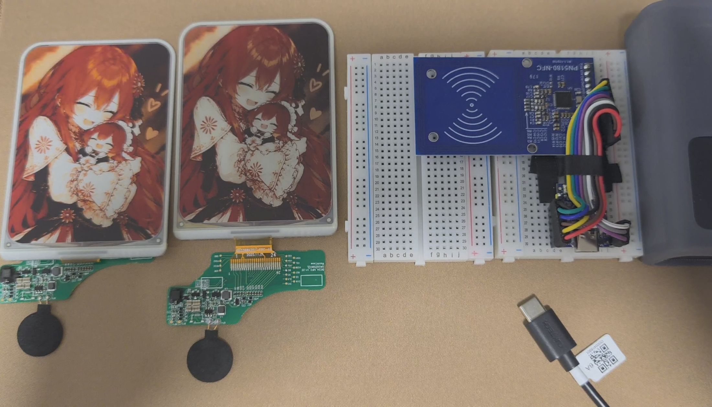
  <br>
  <b>基于 ESP32-C3 + PN5180 13.56MHz 射频的无源四色电泳墨水屏驱动与现代化 Web 工作台</b>
  <br>
  <i>零依赖无电池 · 手机电脑免驱动直连 · 前端全量离线图像引擎 · 纯正弦波高压电泳无扰护航</i>
</p>

---

## 项目亮点

- **100% 纯无源射频供电**：
  - 墨水屏无需任何电池，依靠 PN5180 发射的 13.56MHz 纯正弦波高频载波进行能量收集与升压。
  - 刷新完成后微胶囊粒子双稳态物理固化，画面永久保存，射频自动断电，零漏电零耗能。
- **前端全量离线图像引擎 & 纯 RAM 内存直传**：
  - 图像裁切、四向旋转、色调映射、4 种电泳抖动算法、2bpp 打包与字节对齐 LZO1X 压缩**彻底交给手机/电脑浏览器执行**；
  - ESP32-C3 固件开辟 112KB 静态 DRAM 缓冲区实现**纯内存零拷贝直传**（**0 Flash 擦写、0 闪存磨损、毫秒级秒收**），彻底杜绝 Flash 写入卡顿、寿命衰减与堆内存碎片。
- **手机免配网·开箱即用（SoftAP 模式）**：
  - ESP32-C3 默认自带开放 Wi-Fi 热点 `EPD-3.98-NFC`，默认静态网关 `192.168.4.1`；
  - 固件集成 UDP 53 端口 DNS 劫持（Captive Portal），手机连接热点后自动弹出 Web 刷图工作台；
  - 单片机内嵌 Gzip 硬件压缩网页 (`epd_studio_html.h`)，页面加载毫秒级瞬启。
- **本地 Python Web 护航工作台（PC 模式）**：
  - 电脑端运行 `python tools/web_server.py`，浏览器访问 `http://localhost:8080/`；
  - 点击“一键刷入”即可通过 USB 串口向 ESP32-C3 RAM 极速直传点阵分包，并启动全生命周期电泳波形监听。
- **4 种精选电泳色彩算法**：
  - 涵盖照片全彩过渡、胶片复古、二次元动漫线稿与古典黑白水墨，针对 JD79665AA 红/黄/黑/白粒子特性深度定制。
- **四向屏幕自适应与手势锁定**：
  - 原生支持 `横屏 0° (768×552)`、`竖屏 90° (552×768)`、`倒置横屏 180°`、`反向竖屏 270°`；
  - 独创平移防误触胶囊按钮，彻底解决移动端触控滚动页面被画布拦截手势的交互痛点。

---

## 实物效果与软件界面

| 3.98" 墨水屏物理刷入成品 | 现代化 Web 刷图工作台 |
| :---: | :---: |
|  | 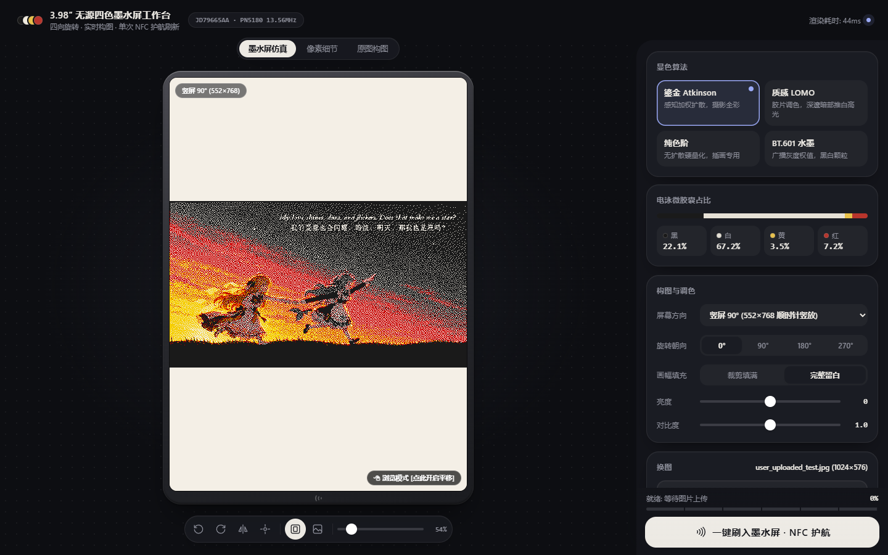 |

---

## 硬件接线说明 (ESP32-C3 & PN5180)

本系统采用 **ESP32-C3** 主控芯片通过标准硬件 SPI 总线（SPI2_HOST，7MHz 时钟速率）驱动 **NXP PN5180** 13.56MHz 高性能 NFC 前端芯片。

### 1. 引脚映射定义表

| PN5180 引脚 | ESP32-C3 GPIO | 功能说明 | 硬件配置与备注 |
| :--- | :--- | :--- | :--- |
| **SCK** | **GPIO 4** | SPI 时钟输入 (CLK) | 推荐 SPI 时钟频率 7MHz |
| **MISO** | **GPIO 5** | SPI 主机输入从机输出 (MISO) | PN5180 状态与数据回传 |
| **MOSI** | **GPIO 6** | SPI 主机输出从机输入 (MOSI) | 指令与点阵 APDU 分包下发 |
| **NSS / CS** | **GPIO 7** | SPI 片选 (Chip Select) | 低电平有效，软件控制片选拉低 |
| **BUSY** | **GPIO 3** | 硬件忙状态信号 (BUSY) | 输入引脚，下拉；高电平表示芯片内部正在处理 |
| **RST** | **GPIO 2** | 硬件复位信号 (RESET) | 输出引脚，上拉；低电平硬件复位 |
| **VCC** | **3.3V / 5V** | 模块供电 | 模块板载 3.3V LDO 时建议接 5V 以确保射频功率充沛 |
| **GND** | **GND** | 信号地与电源共地 | 务必确保 ESP32-C3 与 PN5180 良好共地 |
| **REQ / AUX**| *悬空 (NC)* | 辅助中断 / 请求引脚 | 驱动已走状态寄存器与 BUSY 轮询，无需引出 |

> [!IMPORTANT]
> **供电建议**：PN5180 在发射纯正弦波为墨水屏储能电容充电和电泳迁移时，瞬时射频发射电流可达 150mA~250mA。请确保 ESP32-C3 供电稳定（建议使用优质 USB 数据线连接电脑 USB 3.0 接口，或使用 5V 1A 以上充电头供电）。

### 2. 接线拓扑图与硬件实物

<table>
  <tr>
    <td align="center">
      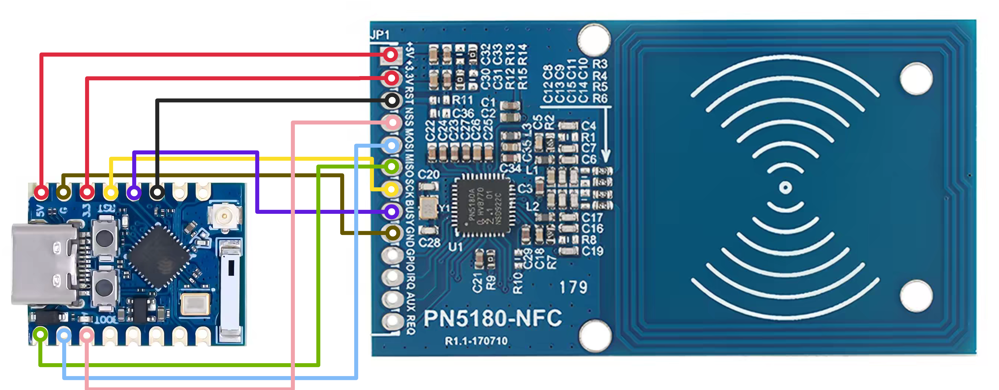<br>
      <b>图 1：ESP32-C3 与 PN5180 Fritzing 接线拓扑图</b>
    </td>
    <td align="center">
      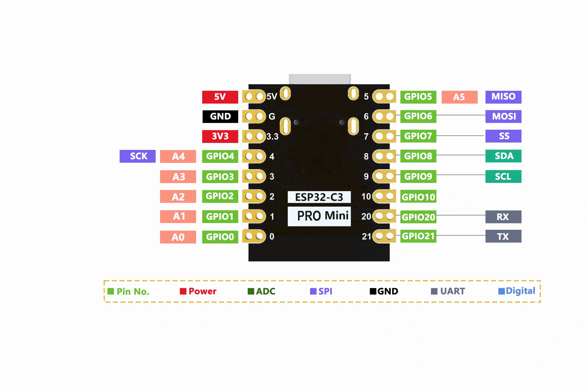<br>
      <b>图 2：ESP32-C3 PROMini 引脚图</b>
    </td>
  </tr>
  <tr>
    <td align="center">
      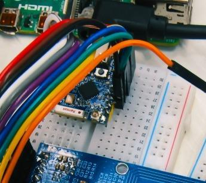<br>
      <b>图 3：实际硬件飞线连接实拍</b>
    </td>
    <td align="center">
      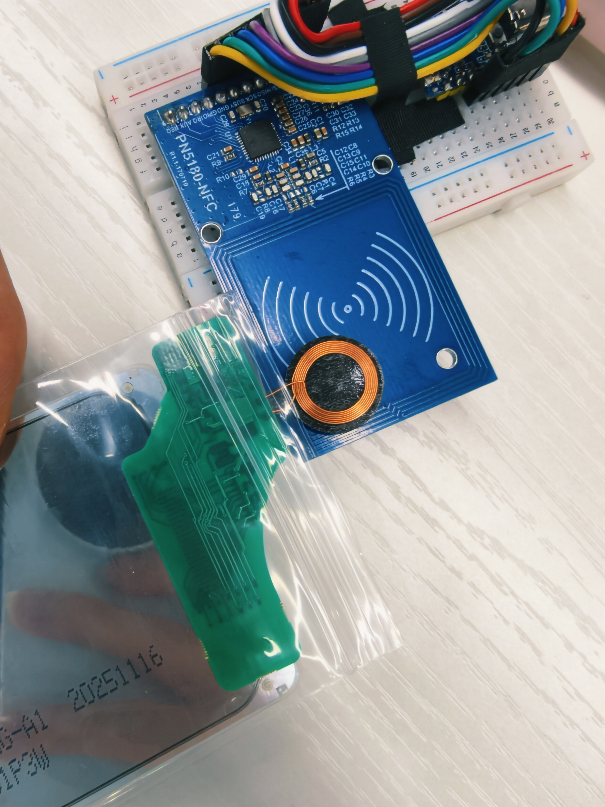<br>
      <b>图 4：3.98 寸无源墨水屏天线线圈居中贴合规范</b>
    </td>
  </tr>
</table>

---

## 4 种精选电泳显色算法

JD79665AA 无源墨水屏采用电子微胶囊电泳显示技术，仅具备 **纯黑、底白、纯黄、纯红** 4 种物理微胶囊粒子。为在 4 色粒子物理限制下呈现层次分明的艺术效果，工作台内置了经过深度量化优化的 4 档渲染引擎：

<table>
  <tr>
    <td align="center">
      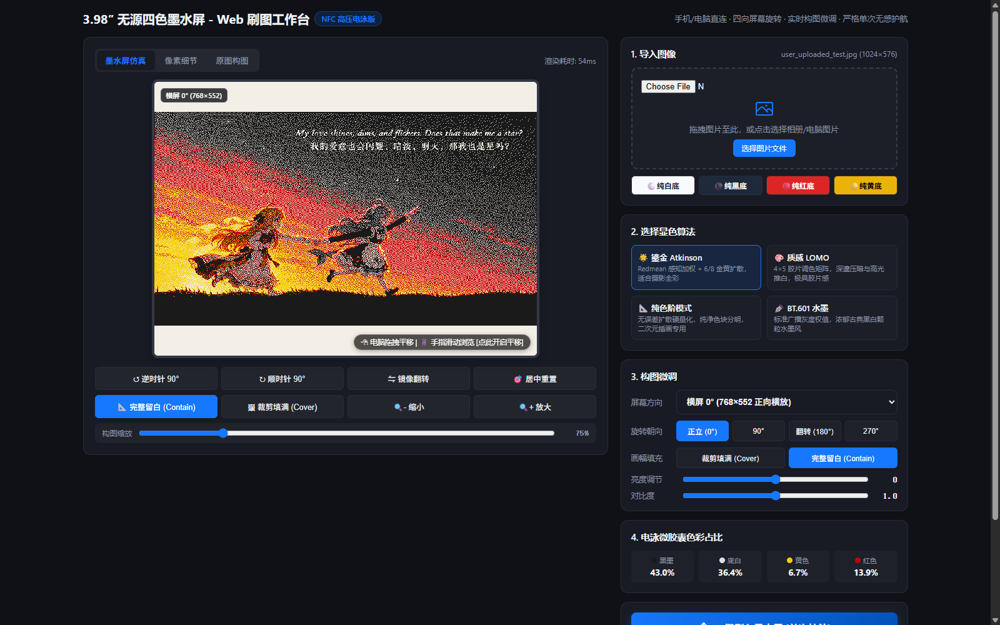<br>
      <b>鎏金 Atkinson 模式</b><br>
      <sub>Redmean 感知加权 + 6/8 金黄误差扩散，晚霞渐变细腻，星空点缀自然，全彩摄影首选</sub>
    </td>
    <td align="center">
      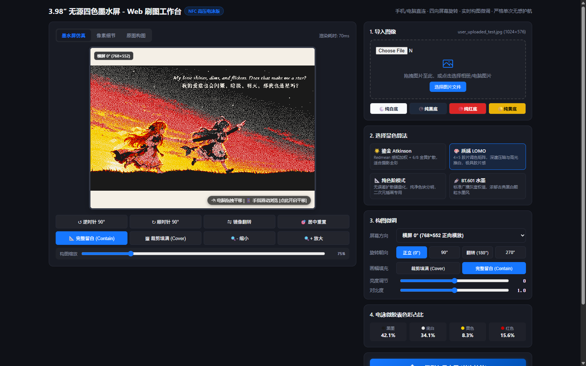<br>
      <b>质感 LOMO 模式</b><br>
      <sub>4×5 胶片调色矩阵，深邃压暗与高光推白，暖黄与落日红浓郁饱满，层次鲜明</sub>
    </td>
  </tr>
  <tr>
    <td align="center">
      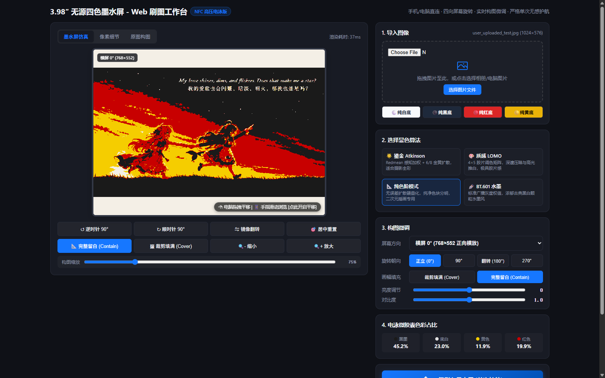<br>
      <b>纯色阶模式</b><br>
      <sub>无误差扩散硬量化，纯净色块边缘极为锐利，二次元插画、动漫线稿还原度最高</sub>
    </td>
    <td align="center">
      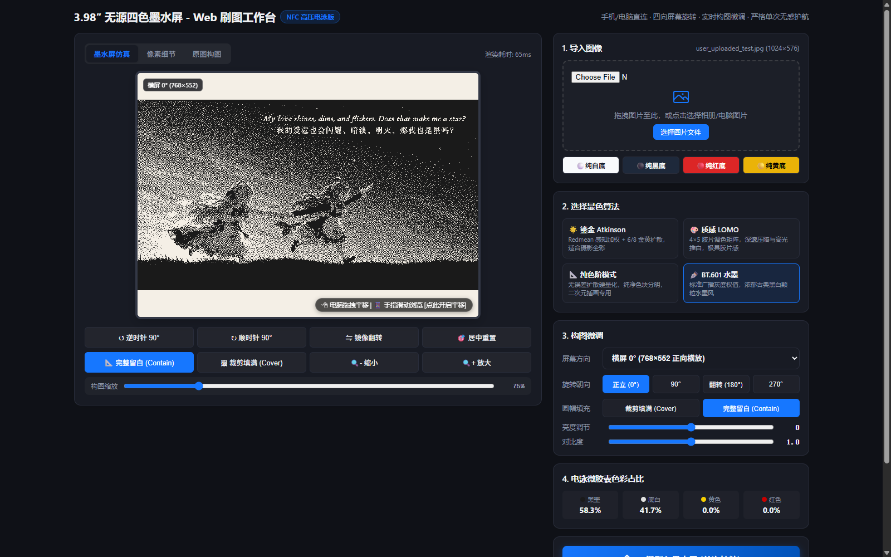<br>
      <b>BT.601 水墨模式</b><br>
      <sub>广播级灰度权值，黄红归零，呈现浓郁素描古典黑白颗粒质感</sub>
    </td>
  </tr>
</table>

---

## 移动端交互设计

针对手机浏览器触控操作特性，工作台进行了针对性优化：

1. **四向旋转与视口自适应**：
   - 支持 `横屏 0° (768×552)`、`竖屏 90° (552×768)`、`倒置横屏 180°`、`反向竖屏 270°`；
   - 切换方向时，画布容器实时调整长宽比，前端实时重构坐标映射矩阵（物理点阵下发前已完成矩阵转置，无需耗费 MCU 计算力）。
2. **平移防误触胶囊按钮**：
   - 传统全画布监听手势会导致手机页面无法正常上下滑动；
   - 默认处于 `[浏览模式] 点击开启平移`，用户可自如滚动页面；
   - 点击激活变为 `[平移已锁定] 点此恢复滑动`，开启 1:1 像素级精准指尖构图拖拽。

<p align="center">
  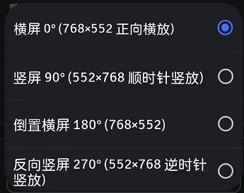
  &nbsp;&nbsp;&nbsp;&nbsp;
  
</p>

---

## 固件架构与 6 阶段电泳护航原理

JD79665AA 无源墨水屏在物理微胶囊电泳迁移过程中需要 ±15V 的高压电泳驱动。固件严格遵循高压电泳物理规律，建立了闭环安全护航链路：


### 源码实现分阶段剖析

1. **Stage 1 · 智能寻卡与谐振检测** (`firmware/main/iso14443_isodep.c`)：
   - 开启 PN5180 13.56MHz 射频场，下发 7-bit 短帧 `0x7A`（备选 `0x52` WUPA）唤醒被动标签；
   - 执行防冲突级联 CL1（`0x93 0x20`），校验 BCC 后执行 Select CL1（`0x93 0x70`），获取 4 字节 UID 与 SAK；
   - 读取 PN5180 `REG_RF_STATUS` 寄存器获取 AGC 值（最佳贴合 coupling 约 130~190），若耦合不佳则自动执行射频复位。
2. **Stage 2 · 母线储能预充电 (2000ms)** (`firmware/main/wifi_portal.c`)：
   - 保持 13.56MHz 纯正弦波无调制连续发射 2000ms，为被动标签内部的 3.3V 储能电容母线充满电量。
3. **Stage 3 · ISO-DEP (RATS) 握手与安全 PIN 认证** (`firmware/main/epd_driver.c`)：
   - 发送 RATS 指令（`0xE0 0x80`，FSDI=8 协商 256 字节最大帧长），建立 ISO-DEP 传输信道；
   - 下发 D1 指令（`0x00 0xD1 0x00 0x00 0x00`）解析 TLV 标签，读取屏幕几何参数（Tag `0xA0`）、扫描方向（Tag `0xA1`，`top_down`）与 UID（Tag `0xC1`）；
   - 下发 D8 指令（`0xF0 0xD8`）进行权限校验，遇 `0x6985` 响应时自动验证标准安全 PIN 码（`0x00 0x20 0x00 0x01 0x05 0x52 0x65 0x69 0x99 0x19`）并解锁写权限。
4. **Stage 4 · D3 点阵分包流式传输** (`firmware/main/epd_driver.c`)：
   - 前端/工具对每 2000 字节块执行字节对齐 LZO1X 压缩并封装为 D3 APDU 指令；
   - 文字与 UI 图像典型约 110~140 个分包，Atkinson 抖动照片约 300~476 包；
   - 子包间严格保证 8ms、块末保证 20ms 的纯载波回血储能间隔；单包通信失败时执行最多 8 次重试，每次重试前追加 100~120ms 纯正弦波回血延时。
5. **Stage 4.5 · MLCC 升压充能 (2000ms)** (`firmware/main/wifi_portal.c`)：
   - 点阵数据传输完成后，纯正弦波持续输出 2000ms，为板载多层陶瓷电容（MLCC）充满启动电荷，确保高压电荷泵启动瞬间不拉垮 3.3V 母线。
6. **Stage 5 · D4 高压电泳软启动** (`firmware/main/epd_driver.c`)：
   - 下发专用 D4 软启动指令（`0xF0 0xD4 0x94 0x80 0x00`），以 2000ms 脉宽参数启动片上电荷泵。
7. **Stage 6 · 22 秒满血电泳护航** (`firmware/main/epd_driver.c`)：
   - **0~22 秒（绝对纯载波护航）**：严禁发送任何空中数据与查询指令，杜绝 100% ASK 调制切波导致的高压泵欠压停机（Brownout `68CA`），确保红、黑、黄三色微胶囊粒子在 ±15V 电场下充分迁移定型；
   - 22 秒后可按需执行闭环 CMD_DE 状态确认。
8. **4 步安全关机序列** (`firmware/main/epd_driver.c`)：
   - 确认 DE 空闲 -> 保持载波 4000ms 泄放 ±15V 高压电荷泵轨 -> 发送 `S(DESELECT)` 与 `HLTA` 挂起射频会话 -> 彻底关闭射频天线场（`pn5180_rf_field_off()`，防止线圈持续发热）。

---

## 快速上手教程

### 途径一：免安装环境 · 一键刷入出厂固件（推荐）

1. 使用 USB 数据线连接 ESP32-C3 开发板至电脑；
2. 进入 `releases/` 目录：
   - **Windows 用户**：直接双击运行 [`releases/flash_firmware.bat`](releases/flash_firmware.bat)；
   - **全平台用户**：在终端运行：
     ```bash
     python releases/flash_firmware.py
     ```
3. 工具将自动探测 COM 串口并烧录出厂固件（包含 Bootloader、分区表与驱动程序）。
4. 烧录完成后，手机搜索并连接 Wi-Fi **`EPD-3.98-NFC`**（开放无密码），浏览器打开 **`http://192.168.4.1/`** 即可开始刷屏。

---

### 途径二：本地电脑 Web 工作台使用 (PC 模式)

1. 安装基础依赖：
   ```bash
   pip install -r tools/requirements.txt
   ```
2. 启动本地服务：
   ```bash
   python tools/web_server.py
   ```
3. 打开电脑浏览器访问 `http://localhost:8080/`，导入任意图片，实时微调构图与算法后，点击 **“一键刷入墨水屏 (单次护航)”**，即可通过 USB 串口实现内存直传与全自动刷屏。

---

### 途径三：ESP-IDF 源码开发与二次编译

- **工具链要求**：ESP-IDF v5.x / v6.x（已在 ESP-IDF v6.1.0 编译验证；`sdkconfig.defaults` 已预设 esp32c3 目标及 160MHz 主频配置）
- **编译与烧录命令**：
  ```bash
  cd firmware
  idf.py set-target esp32c3
  idf.py build
  idf.py -p COMxx flash monitor
  ```
- **串口交互指令**：
  固件内置了串口非阻塞控制台监听：
  - 输入 `r` 或 `R`：重新触发刷入当前 RAM 缓冲区中驻留的图像；
  - 输入 `u` 或 `U`：启动串口十六进制流直传模式，将外部点阵数据直写 112KB RAM 缓冲区并触发刷新。

---

## 项目结构规范

```
.
├── LICENSE                     # PolyForm-Noncommercial 开源许可证
├── README.md                   # 中文主文档与接线指引
├── README_EN.md                # 英文主文档
├── .gitignore                  # Git 忽略配置 (已包含 build/ 与临时缓存)
├── docs/                       # 硬件接线与界面效果图
│   └── images/
│       ├── image2.png                  # 3.98 寸无源墨水屏真实显色效果大图
│       ├── IMG_20261109_001901.jpg     # 实屏显色实拍照片
│       ├── web_studio_complete.png     # 工作台完成状态截图
│       ├── esp32c3_pn5180_fritzing.png # Fritzing 接线拓扑图
│       ├── ESP32C3.png                 # ESP32-C3 PROMini 引脚定义
│       ├── hardware_actual_wiring.jpg  # 实际硬件飞线连接照片
│       ├── image_1.jpg                 # 天线居中贴合规范
│       ├── orientation_dropdown.png    # 方向选择菜单
│       ├── pan_locked_pill.png         # 平移防误触胶囊按钮
│       ├── pn5180_pinout.png           # PN5180 模块引脚定义
│       └── algo_*.png                  # 4 种算法效果对比图
├── android/                    # Android 手机端 NFC 原生读写工程 (QPollLab)
│   ├── AndroidManifest.xml     # 清单文件与 NFC/Shizuku 权限配置
│   ├── build.gradle            # Gradle 构建配置
│   ├── settings.gradle         # Gradle 仓库与工程配置
│   ├── build.py                # 免 Gradle 快速构建脚本
│   ├── src/                    # Java 源码 (IsoDep、PanelProtocol、QPollWorker 等)
│   ├── res/                    # 资源文件 (图标、样式)
│   ├── libs/                   # 依赖库 (Shizuku AAR)
│   ├── assets/                 # 开源许可声明
│   └── dist/                   # 预构建 APK 安装包
├── firmware/                   # ESP-IDF C 语言驱动工程
│   ├── CMakeLists.txt          # CMake 构建工程入口
│   ├── sdkconfig.defaults      # 默认 SDK 配置 (ESP32-C3, 160MHz, USB-JTAG Console)
│   └── main/
│       ├── CMakeLists.txt      # 组件构建脚本
│       ├── main.c              # 启动编排、纯 RAM 直传与串口命令监听
│       ├── pn5180_hal.c/.h     # PN5180 硬件 SPI/寄存器/射频控制驱动
│       ├── epd_driver.c        # 墨水屏握手/传输/22s 电泳护航/安全关机
│       ├── epd_protocol.h      # APDU 协议数据结构与协议常量
│       ├── iso14443_isodep.c/.h# ISO 14443-3A 与 ISO-DEP (Type A) 通信协议栈
│       ├── wifi_portal.c/.h    # SoftAP 热点/DNS Captive/112KB DRAM/HTTP 服务
│       └── epd_studio_html.h   # Gzip 压缩内嵌单文件 Web 工作台
├── tools/                      # 离线处理工具与本地 Web 调试器
│   ├── epd_studio.html         # 核心纯前端单文件工作台 (换图导出/构图调色/显色算法)
│   ├── web_server.py           # 本地 PC Web 服务与 USB 串口 RAM 直传
│   ├── build_fw.py             # ESP-IDF 固件编译脚本
│   ├── do_flash.py             # 串口一键烧录脚本
│   ├── flash_and_monitor.py    # 固件烧录及全周期串口监视器
│   ├── update_html_header.py   # 将 epd_studio.html 压缩更新至 epd_studio_html.h
│   ├── qpoll_codec.py          # Python 核心编解码与四档算法
│   ├── generate_qpoll_header.py# 离线生成 C 语言点阵头文件
│   └── requirements.txt        # Python 依赖清单
└── releases/                   # 出厂编译固件与单键烧录脚本
    ├── pn5180_epd_driver.bin   # 编译完成的驱动主固件 (112KB RAM 直传)
    ├── bootloader.bin          # 二阶段引导程序
    ├── partition-table.bin     # 单分区结构表
    ├── flash_firmware.py       # 自动探测串口全量烧录脚本
    └── flash_firmware.bat      # Windows 一键执行批处理
```

---

## 致谢与参考开源项目

本项目得以实现并达到高品质效果，由衷感谢以下开源项目与技术文献：

1. **[huawei-epd-pn532](https://gitee.com/kur0neko/huawei-epd-pn532)**：
   - NFC 协议层与工厂扫描打包（`PanelProtocol` 的 D1/D3/D4 指令序列、四色扫描方向、PIN 流程）——最早的代码起点。
2. **[qpoll-lite (by yhl88890)](https://github.com/yhl88890/qpoll-lite)**：
   - 为本项目的 LZO1X 块压缩协议设计、D3/D4 APDU 指令格式及 ISO-DEP 传输实现提供了重要蓝本与理论支持。
3. **[NXP Semiconductors PN5180 官方芯片资料](https://www.nxp.com/products/rfid-nfc/nfc-hf/nfc-readers/high-performance-nfc-frontend:PN5180)**：
   - 提供了 PN5180 高性能 13.56MHz NFC 前端芯片的硬件寄存器定义、射频功率控制、AGC 谐振探测与 ISO-14443A 射频时序规格。
4. **[tueddy/PN5180-Library](https://github.com/tueddy/PN5180-Library)**：
   - 提供了 SPI 指令序列、ISO-14443A 激活流程与 Fritzing 接线拓扑参考。

---

## 开源许可证

本项目基于 **[PolyForm-Noncommercial-1.0.0](https://github.com/polyformproject/polyform-licenses/blob/1.0.0/PolyForm-Noncommercial-1.0.0.md)** 协议开源。

- **允许用途**：个人学习研究、实验测试、业余爱好、非商业组织（教育、公共研究、政府机构等）免费使用与修改衍生。
- **限制条款**：严禁未经许可将本项目源码、固件、算法或衍生作品用于任何商业牟利、商业集成或商业闭源销售。商业用途请联系作者获取独立商业授权。
- **开源协作**：欢迎广大电子爱好者、创客与工程师学习交流、提交 Issue 与 PR，共同推进无源电子纸技术的创新应用！
