# 3.98" Passive NFC 4-Color E-Paper (JD79665AA) Web Studio

<p align="center">
  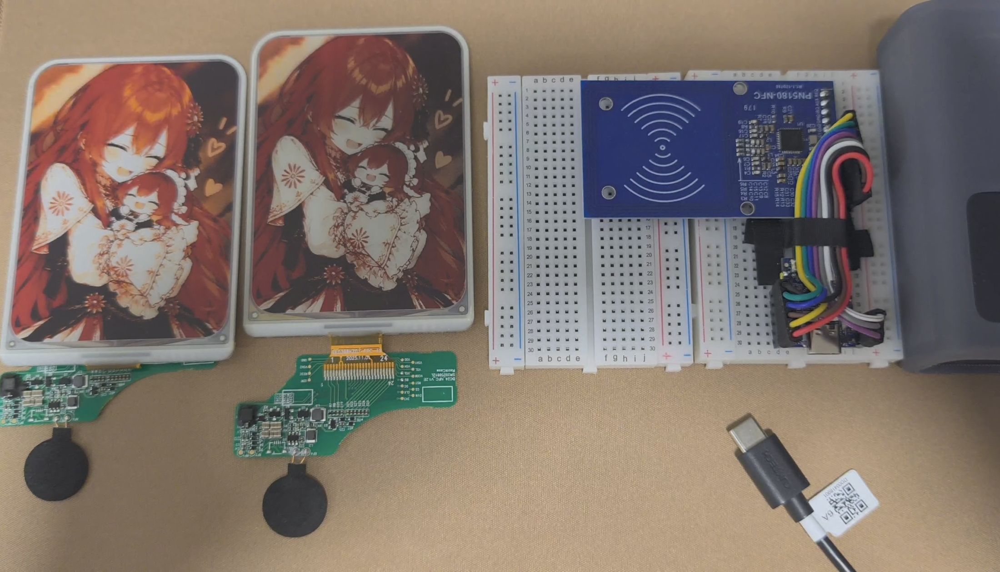
  <br>
  <b>Passive 4-Color Electrophoretic E-Paper Driver and Modern Web Studio for ESP32-C3 + PN5180 13.56MHz RF</b>
  <br>
  <i>Zero-Battery · Zero-Driver Mobile/PC Direct Connection · 100% Client-Side Offline Image Engine · Pure Sine-Wave High-Voltage Escort</i>
</p>

---

## Highlights

- **100% Battery-Free Passive RF Power**:
  - The display panel requires no battery. Powered entirely by 13.56 MHz pure sine-wave carrier energy harvested via NXP PN5180.
  - The electrophoretic display is bi-stable: after completion, the image is retained permanently without power, and RF field is automatically shut down.
- **100% Client-Side Offline Image Engine & Pure RAM Direct Streaming**:
  - Cropping, 4-direction rotation, color palette mapping, 4 curated dithering algorithms, 2bpp packing, and byte-aligned LZO1X block compression are **completely handled in the mobile or PC browser**.
  - ESP32-C3 firmware allocates a 112 KB static DRAM buffer for **pure RAM zero-copy streaming** (**0 Flash erase, 0 flash wear, millisecond throughput**), eliminating SPI flash wear, write stalls, and dynamic heap fragmentation.
- **Out-of-the-Box Standalone SoftAP Mode**:
  - ESP32-C3 broadcasts an open Wi-Fi AP `EPD-3.98-NFC` (default IP: `192.168.4.1`).
  - Integrated UDP port 53 DNS captive portal automatically prompts the web studio when connected on smartphones.
  - Embedded Gzip hardware-compressed web application (`epd_studio_html.h`) launches instantly.
- **Local PC Companion Studio**:
  - Run `python tools/web_server.py` and open `http://localhost:8080/` in any browser.
  - Click "Flash to EPD" to stream pre-compressed packets directly into ESP32-C3 RAM via USB serial with full real-time electrophoretic lifecycle monitoring.
- **4 Curated Electrophoretic Dithering Algorithms**:
  - Custom tuned for JD79665AA physical black/white/yellow/red pigment microcapsules, including smooth portrait photography, vintage film look, anime line art, and classical monochrome ink.
- **4-Direction Screen Orientation & Mobile Touch Lock Capsule**:
  - Native support for `Landscape 0° (768×552)`, `Portrait 90° (552×768)`, `Inverted Landscape 180°`, and `Inverted Portrait 270°`.
  - Floating gesture pill `[Browsing Mode]` vs `[Pan Locked]` prevents canvas touch events from hijacking page scrolling on mobile devices.

---

## Actual Refresh Results & Web Studio

| 3.98" E-Paper Physical Refresh Result | Modern Web Studio Interface |
| :---: | :---: |
|  | 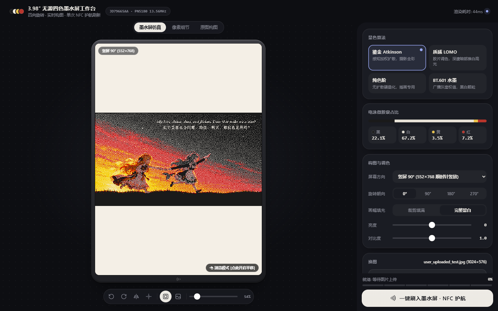 |

---

## Hardware Pinout (ESP32-C3 & PN5180)

The system utilizes an **ESP32-C3** MCU communicating with an **NXP PN5180** high-performance 13.56 MHz NFC frontend via hardware SPI (SPI2_HOST at 7 MHz clock rate).

### 1. Pin Mapping Table

| PN5180 Pin | ESP32-C3 GPIO | Description | Notes |
| :--- | :--- | :--- | :--- |
| **SCK** | **GPIO 4** | SPI Clock (CLK) | 7 MHz SPI clock recommended |
| **MISO** | **GPIO 5** | SPI Master In Slave Out (MISO) | PN5180 data return |
| **MOSI** | **GPIO 6** | SPI Master Out Slave In (MOSI) | Commands & APDU packet transfer |
| **NSS / CS** | **GPIO 7** | SPI Chip Select | Active low |
| **BUSY** | **GPIO 3** | Hardware Busy Signal | Input, pull-down; high when processing internal commands |
| **RST** | **GPIO 2** | Hardware Reset | Output, pull-up; active low |
| **VCC** | **3.3V / 5V** | Power Supply | 5V recommended if module has onboard 3.3V LDO for full RF output power |
| **GND** | **GND** | Ground | Common ground must be solidly connected |
| **REQ / AUX**| *NC* | Interrupt / Request | Handled via status register polling, leave unconnected |

> [!IMPORTANT]
> **Power Supply Requirement**: PN5180 transient RF transmission current can reach 150mA~250mA during high-voltage electrophoretic charging. Ensure ESP32-C3 has a stable power supply (connect to a USB 3.0 port or a 5V 1A+ power adapter).

### 2. Wiring & Placement Diagrams

<table>
  <tr>
    <td align="center">
      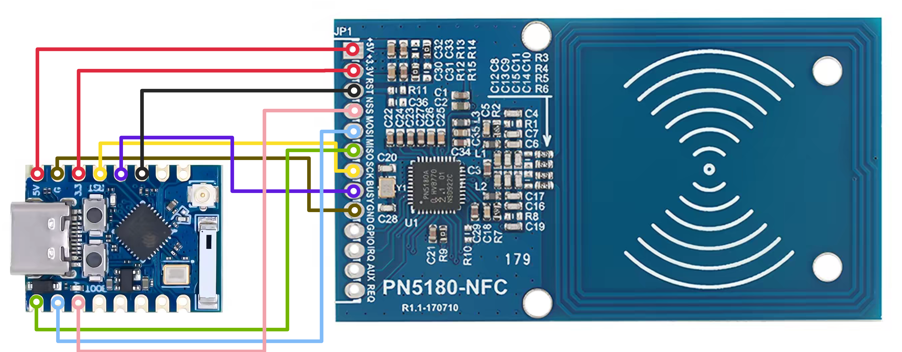<br>
      <b>Figure 1: ESP32-C3 and PN5180 Fritzing Wiring Topology</b>
    </td>
    <td align="center">
      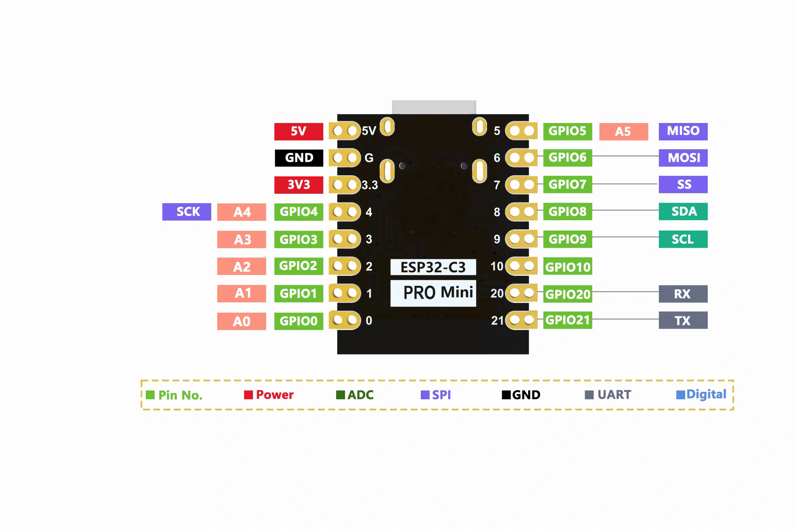<br>
      <b>Figure 2: ESP32-C3 PROMini Pinout</b>
    </td>
  </tr>
  <tr>
    <td align="center">
      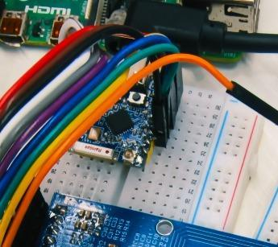<br>
      <b>Figure 3: Physical Hardware Wiring Photograph</b>
    </td>
    <td align="center">
      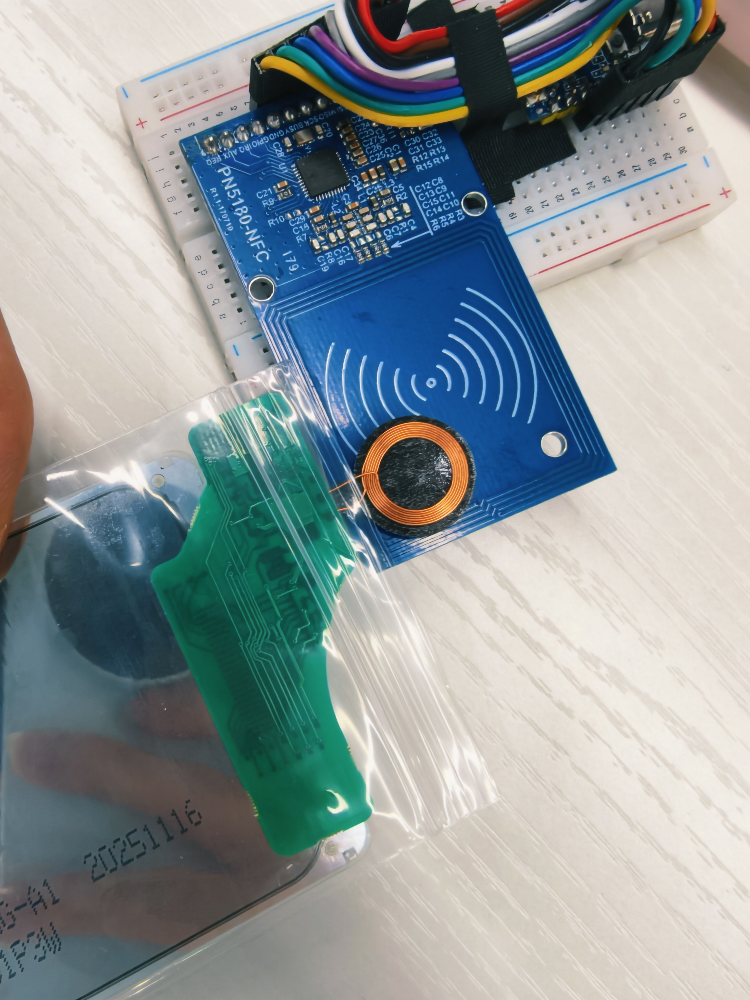<br>
      <b>Figure 4: 3.98-Inch Passive EPD Antenna Coil Alignment</b>
    </td>
  </tr>
</table>

---

## 4 Curated Electrophoretic Dithering Algorithms

The JD79665AA e-paper utilizes electrophoretic microcapsules containing **black, white, yellow, and red** physical pigment particles. To produce outstanding visual fidelity within these hardware constraints, 4 rendering modes are provided:

<table>
  <tr>
    <td align="center">
      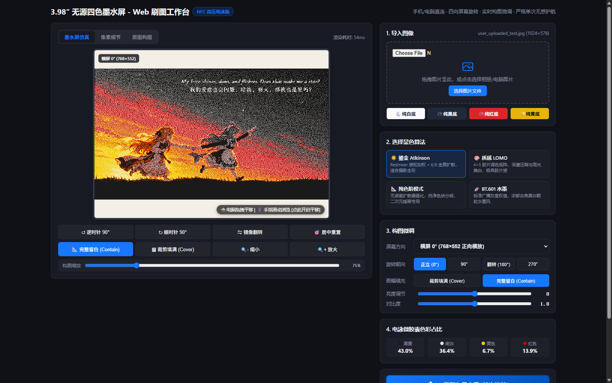<br>
      <b>Gilded Atkinson Mode</b><br>
      <sub>Redmean perceptual weighting + 6/8 gold error diffusion. Smooth color gradients, ideal for portrait and full-color photography.</sub>
    </td>
    <td align="center">
      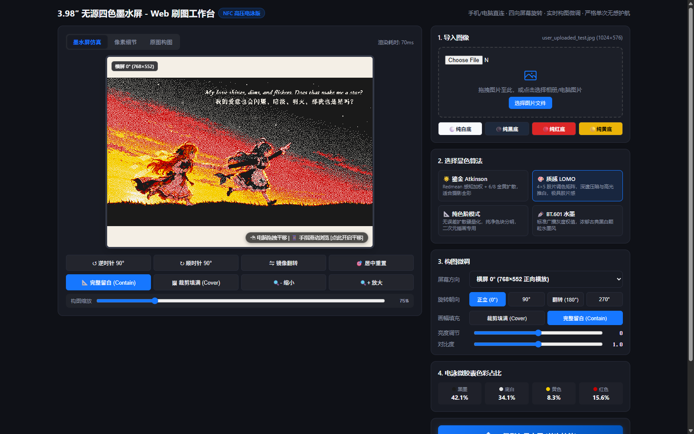<br>
      <b>LOMO Texture Mode</b><br>
      <sub>4×5 film tone matrix with deep shadow crush and warm saturated highlights. Rich contrast and vivid tones.</sub>
    </td>
  </tr>
  <tr>
    <td align="center">
      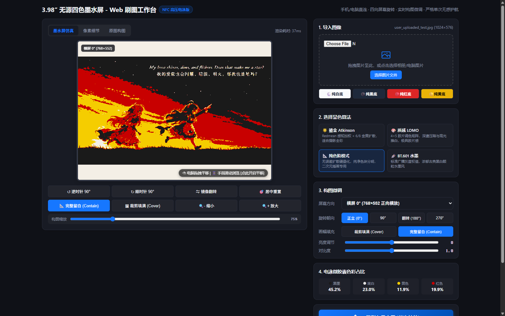<br>
      <b>Flat Level Mode</b><br>
      <sub>Zero-diffusion hard threshold quantization. Ultra-crisp solid color boundaries, best for anime, illustrations, and vector artwork.</sub>
    </td>
    <td align="center">
      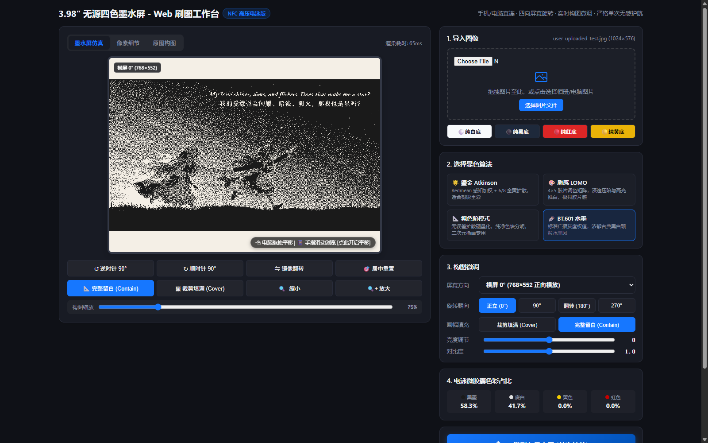<br>
      <b>BT.601 Ink Mode</b><br>
      <sub>Broadcast-standard grayscale weighting with yellow and red zeroed out. Produces vintage monochrome sketch textures.</sub>
    </td>
  </tr>
</table>

---

## Mobile Touch Interaction Design

Designed specifically for smartphone browsers:

1. **4-Direction Rotation with Viewport Adaptation**:
   - Supports `Landscape 0° (768×552)`, `Portrait 90° (552×768)`, `Inverted Landscape 180°`, and `Inverted Portrait 270°`.
   - Changing orientation dynamically updates the viewport aspect ratio and transforms the image matrix on the client side without MCU overhead.
2. **Pan Lock Capsule Button**:
   - Canvas touch listeners usually block page scrolling on mobile devices.
   - Defaults to `[Browsing Mode] Click to Enable Pan` so users can scroll normally.
   - Tapping it activates `[Pan Locked] Click to Restore Scroll` for 1:1 pixel-level canvas composition adjustment.

<p align="center">
  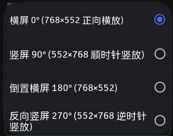
  &nbsp;&nbsp;&nbsp;&nbsp;
  
</p>

---

## Firmware Architecture & 6-Stage Electrophoretic Escort Pipeline

The JD79665AA panel requires ±15V driving voltages during microcapsule migration. The firmware enforces a closed-loop RF escort sequence:

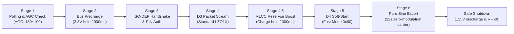

### Stage Details

1. **Stage 1 · Smart Polling & Resonance Check** (`firmware/main/iso14443_isodep.c`):
   - Turns on 13.56 MHz RF field, sends 7-bit wakeup short frame `0x7A` (fallback `0x52` WUPA);
   - Performs anticollision cascade CL1 (`0x93 0x20`), verifies BCC, executes Select CL1 (`0x93 0x70`), retrieves 4-byte UID and SAK;
   - Reads PN5180 `REG_RF_STATUS` AGC register (optimal coupling ~130~190).
2. **Stage 2 · 3.3V Bus Precharge (2000ms)** (`firmware/main/wifi_portal.c`):
   - Continuous unmodulated 13.56 MHz pure sine carrier fills passive storage capacitors on the panel.
3. **Stage 3 · ISO-DEP (RATS) Handshake & PIN Authentication** (`firmware/main/epd_driver.c`):
   - Sends RATS (`0xE0 0x80`, FSDI=8 for 256-byte maximum frame size) to negotiate ISO-DEP transport;
   - Sends D1 (`0x00 0xD1 0x00 0x00 0x00`) to parse TLV parameters (Tag `0xA0` geometry, Tag `0xA1` scan direction `top_down`, Tag `0xC1` UID);
   - Issues D8 command (`0xF0 0xD8`), verifies standard security PIN (`0x00 0x20 0x00 0x01 0x05 0x52 0x65 0x69 0x99 0x19`) on `0x6985` response to unlock write privileges.
4. **Stage 4 · D3 Packet Stream Transfer** (`firmware/main/epd_driver.c`):
   - Streams LZO1X-compressed D3 APDU blocks (~110-140 packets for text/UI, ~300-476 packets for dithered photos);
   - 8ms carrier gap between subpackets, 20ms gap after each block. Up to 8 retries with 100-120ms recharge pause upon packet failure.
5. **Stage 4.5 · MLCC Reservoir Boost (2000ms)** (`firmware/main/wifi_portal.c`):
   - Pure sine carrier wave saturates multilayer ceramic capacitors (MLCC) to prepare energy for high-voltage pump startup.
6. **Stage 5 · D4 Soft-Start Command** (`firmware/main/epd_driver.c`):
   - Sends D4 soft-start command (`0xF0 0xD4 0x94 0x80 0x00`) with 2000ms pulse width in Fast Mode (`0x80`).
7. **Stage 6 · 22-Second Pure Sine Wave Escort** (`firmware/main/epd_driver.c`):
   - **0~22 seconds (Zero-Modulation Carrier)**: Completely avoids ASK modulation or query packets to prevent charge pump undervoltage shutdown (Brownout `68CA`), giving microcapsule particles uninterrupted time to migrate under ±15V.
8. **4-Step Safe Shutdown Sequence** (`firmware/main/epd_driver.c`):
   - Check DE idle state -> 4000ms carrier hold to discharge ±15V charge pump rails -> send ISO-DEP `S(DESELECT)` and `HLTA` -> turn off RF field (`pn5180_rf_field_off()`).

---

## Quick Start Guide

### Option 1: Pre-Built Factory Firmware (Recommended)

1. Connect ESP32-C3 to your computer via USB;
2. Navigate to `releases/`:
   - **Windows**: Double-click [`releases/flash_firmware.bat`](releases/flash_firmware.bat);
   - **All Platforms**: Run from terminal:
     ```bash
     python releases/flash_firmware.py
     ```
3. The script auto-detects the serial port and flashes bootloader (`0x0`), partition table (`0x8000`), and application (`0x10000`).
4. Connect to Wi-Fi **`EPD-3.98-NFC`** (open, no password) and navigate to **`http://192.168.4.1/`** in your browser.

---

### Option 2: Local PC Companion Studio

1. Install dependencies:
   ```bash
   pip install -r tools/requirements.txt
   ```
2. Start local web server:
   ```bash
   python tools/web_server.py
   ```
3. Open `http://localhost:8080/` in Chrome/Edge, import an image, adjust composition, and click "Flash to EPD".

---

### Option 3: ESP-IDF Source Build & Custom Development

- **Toolchain**: ESP-IDF v5.x / v6.x (verified on v6.1.0; `sdkconfig.defaults` targets `esp32c3` at 160MHz)
- **Build and Flash**:
  ```bash
  cd firmware
  idf.py set-target esp32c3
  idf.py build
  idf.py -p COMxx flash monitor
  ```
- **Serial Console Commands**:
  - Type `r` or `R`: Re-triggers physical refresh using image in RAM buffer;
  - Type `u` or `U`: Starts serial hex stream direct RAM upload mode.

---

## Repository Structure

```
.
├── LICENSE                     # PolyForm-Noncommercial Open Source License
├── README.md                   # Chinese Documentation
├── README_EN.md                # English Documentation
├── .gitignore                  # Git Ignore Configuration
├── docs/                       # Hardware Pinout & Wiring Diagrams
│   └── images/
│       ├── image2.png                  # EPD Refresh Result Banner
│       ├── IMG_20261109_001901.jpg     # Screen Photograph
│       ├── web_studio_complete.png     # Web Studio Screenshot
│       ├── esp32c3_pn5180_fritzing.png # Fritzing Wiring Topology
│       ├── ESP32C3.png                 # ESP32-C3 PROMini Pinout
│       ├── hardware_actual_wiring.jpg  # Physical Wiring Photo
│       ├── image_1.jpg                 # Antenna Placement Guide
│       ├── orientation_dropdown.png    # Orientation Menu
│       ├── pan_locked_pill.png         # Pan Lock Capsule Button
│       ├── pn5180_pinout.png           # PN5180 Pinout Reference
│       └── algo_*.png                  # 4 Algorithm Comparison Images
├── android/                    # Android Native NFC Companion App (QPollLab)
│   ├── AndroidManifest.xml     # Manifest with NFC/Shizuku Permissions
│   ├── build.gradle            # Gradle Build Script
│   ├── settings.gradle         # Gradle Settings
│   ├── build.py                # Standalone Build Utility
│   ├── src/                    # Java Source Code
│   ├── res/                    # App Resources
│   ├── libs/                   # Dependency Libraries
│   ├── assets/                 # Third-Party Licenses
│   └── dist/                   # Pre-Built APK
├── firmware/                   # Clean ESP-IDF C Driver Project
│   ├── CMakeLists.txt          # CMake Project Entry
│   ├── sdkconfig.defaults      # Default SDK Configuration
│   └── main/
│       ├── CMakeLists.txt      # Component Build Script
│       ├── main.c              # System Entry, RAM Direct Mode & Serial Monitor
│       ├── pn5180_hal.c/.h     # PN5180 Hardware SPI, Registers & RF Control
│       ├── epd_driver.c        # Protocol Handshake, D3 Streaming & 22s Escort
│       ├── epd_protocol.h      # APDU Protocol Constants & Structures
│       ├── iso14443_isodep.c/.h# ISO 14443-3A & ISO-DEP Protocol Stack
│       ├── wifi_portal.c/.h    # SoftAP, DNS Captive, 112KB RAM & HTTP Server
│       └── epd_studio_html.h   # Gzip Compressed Embedded Web Studio
├── tools/                      # Offline Utilities & Local PC Studio
│   ├── epd_studio.html         # Client-Side Web Studio Single-File App
│   ├── web_server.py           # Local PC Server & USB Serial Direct Streamer
│   ├── build_fw.py             # ESP-IDF Firmware Build Script
│   ├── do_flash.py             # Serial Flash Utility
│   ├── flash_and_monitor.py    # Firmware Flasher & Full Lifecycle Monitor
│   ├── update_html_header.py   # Compresses epd_studio.html to epd_studio_html.h
│   ├── qpoll_codec.py          # Python Core Codec & 4-Color Quantizers
│   ├── generate_qpoll_header.py# Generates C Array Headers
│   └── requirements.txt        # Python Dependencies
└── releases/                   # Pre-Built Binaries & One-Click Flash Tool
    ├── pn5180_epd_driver.bin   # Compiled Driver Firmware (112KB RAM Direct Mode)
    ├── bootloader.bin          # Second-Stage Bootloader
    ├── partition-table.bin     # Partition Table
    ├── flash_firmware.py       # Auto-Detect Port Flash Script
    └── flash_firmware.bat      # Windows Flash Batch Script
```

---

## Acknowledgments & Reference Projects

1. **[huawei-epd-pn532](https://gitee.com/kur0neko/huawei-epd-pn532)**:
   - NFC protocol layer and panel scanning (`PanelProtocol` D1/D3/D4 command sequences, color scanning orientations, PIN auth) - earliest code foundation.
2. **[qpoll-lite (by yhl88890)](https://github.com/yhl88890/qpoll-lite)**:
   - Provided fundamental references for LZO1X block compression protocol design, D3/D4 APDU formats, and ISO-DEP transmission flow.
3. **[NXP Semiconductors PN5180 Official Documentation](https://www.nxp.com/products/rfid-nfc/nfc-hf/nfc-readers/high-performance-nfc-frontend:PN5180)**:
   - PN5180 13.56 MHz high-performance NFC frontend registers, AGC resonance detection, and ISO-14443A RF specifications.
4. **[tueddy/PN5180-Library](https://github.com/tueddy/PN5180-Library)**:
   - Arduino / ESP32 driver library providing key references for SPI commands, ISO-14443A activation sequences, and Fritzing wiring diagrams.

---

## License

This project is licensed under the **[PolyForm-Noncommercial-1.0.0](https://github.com/polyformproject/polyform-licenses/blob/1.0.0/PolyForm-Noncommercial-1.0.0.md)** license.

- **Permitted Purposes**: Free for personal study, experimentation, hobby projects, academic research, and noncommercial organizations (educational, public research, public safety, government, etc.).
- **Commercial Restrictions**: Any commercial use, commercial integration, or commercial exploitation is strictly prohibited without a separate commercial license from the author.
- **Contributions**: Issues and Pull Requests for noncommercial community improvements are warmly welcomed!
